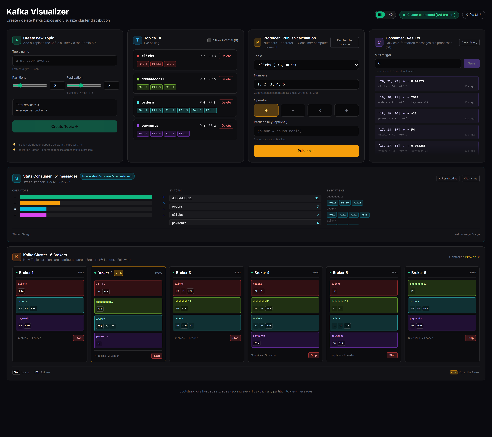
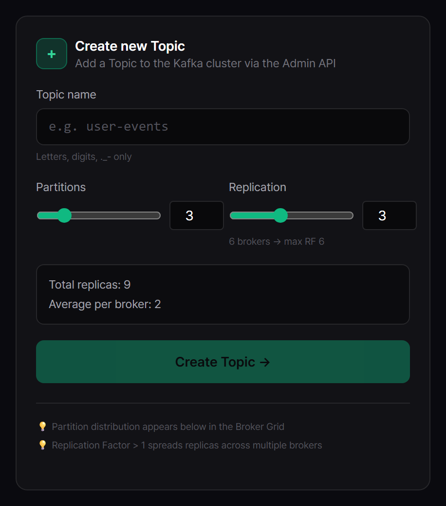
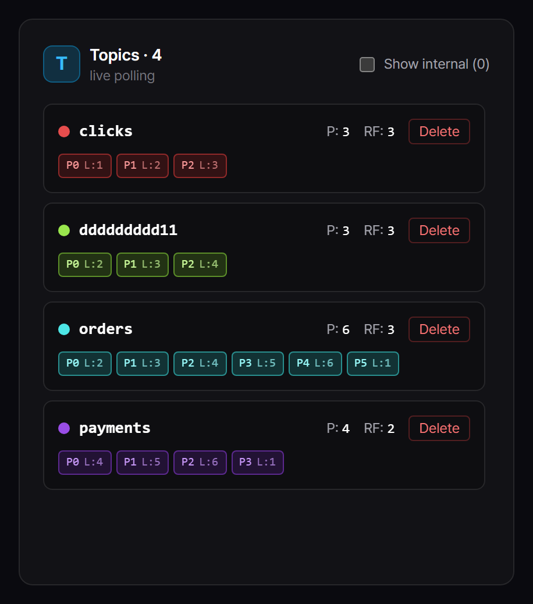
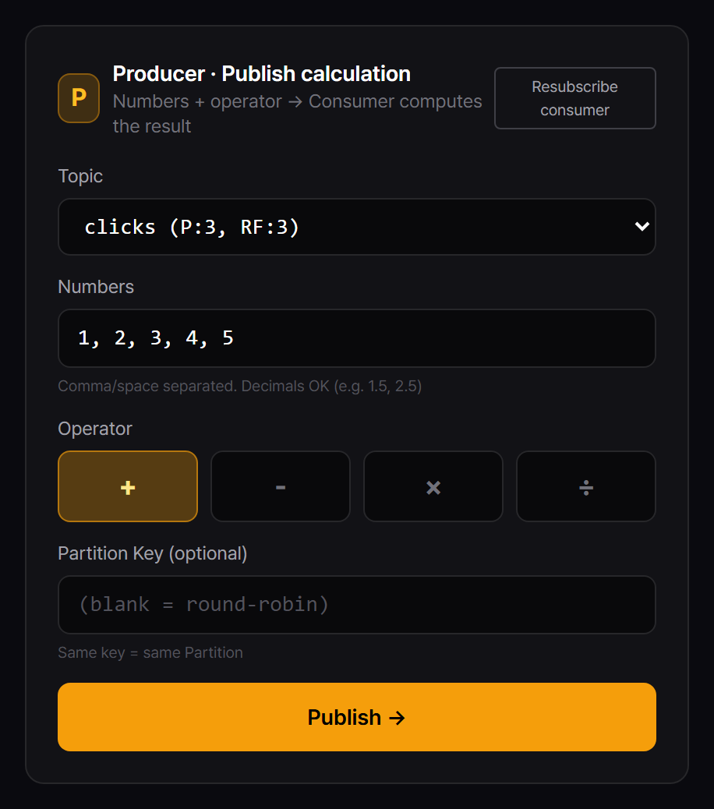
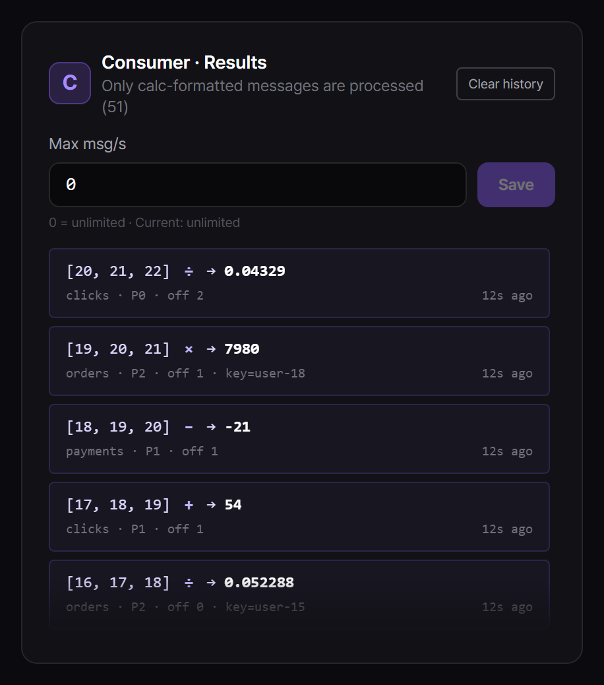
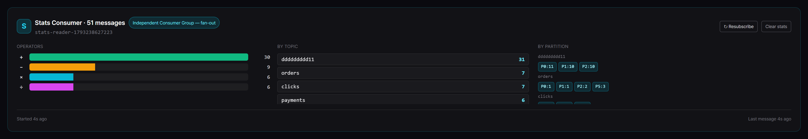
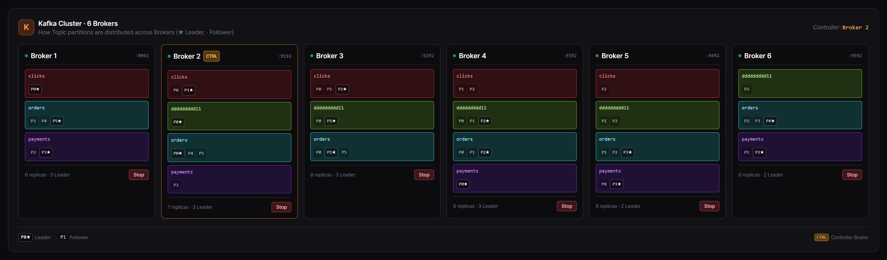
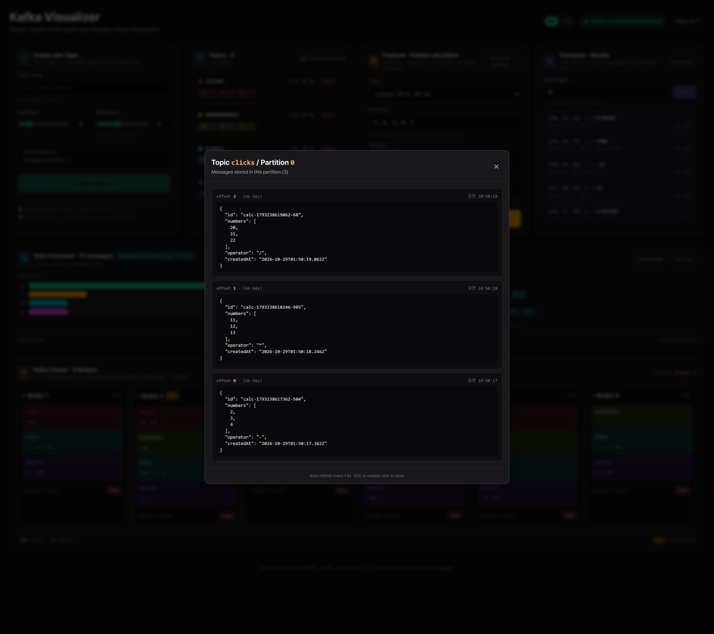

<div align="center">

# 🎯 Kafka Visualizer

**실제 6-broker Apache Kafka 클러스터를 눈으로 보고 조작하는 Next.js 데모**

Topic 생성, 메시지 발행, Leader 재선출, Fan-out, Replay — Kafka의 핵심 메커니즘을 **polling 1.5초마다 실시간**으로 시각화합니다.




</div>

---

## ✨ 이 프로젝트는 무엇인가요

**교육용 Kafka 시각화 데모**입니다. 시뮬레이션이 아니라 **진짜 Kafka**를 Docker로 띄우고, kafkajs 로 붙어서 하는 작업이 UI에 즉시 반영됩니다.

문서로만 보던 개념들을 **직접 눌러보면서** 체감할 수 있어요:

- Partition 복제본이 각 Broker에 어떻게 배정되는지
- Broker 가 죽으면 **Controller 와 Partition Leader 가 어떻게 재선출**되는지
- **두 개의 독립 Consumer Group**이 같은 메시지를 각자 다른 목적으로 처리하는 Fan-out
- Consumer 처리량 제한 시 Producer 와 Consumer 가 **비동기로 분리**되는 모습
- 메시지는 사라지지 않고 **offset 0부터 Replay** 가능하다는 것

**대상:** Kafka 배우는 학생, 백엔드 엔지니어, 인터뷰 때 화이트보드 그리던 사람.

---

## 🧱 아키텍처

```mermaid
flowchart LR
    subgraph UI["Next.js UI (localhost:3000)"]
      CR[Create Topic]
      TL[Topic List]
      PR[Producer]
      CO[Consumer Result]
      ST[Stats Panel]
      BR[Broker Grid]
    end

    subgraph API["Next.js API Routes"]
      direction TB
      AT["/api/topics"]
      AB["/api/brokers"]
      AC["/api/calc/*"]
      AS["/api/stats/*"]
    end

    subgraph KC["Kafka KRaft Cluster"]
      direction TB
      K1[kafka-1 :9092]
      K2[kafka-2 :9192]
      K3[kafka-3 :9292]
      K4[kafka-4 :9392]
      K5[kafka-5 :9492]
      K6[kafka-6 :9592]
    end

    UI -->|1.5s polling| API
    API -->|kafkajs Admin/Producer/Consumer| KC
    KU[Provectus Kafka UI :8080] -.-> KC
```



| Layer | 역할 |
|---|---|
| **Next.js UI** | 1.5s polling, i18n (EN/KO), Pretendard 폰트, 상호작용 애니메이션 |
| **API Routes** | kafkajs 래퍼, 서버 상태 (producer / 2개 consumer / stats 집계) |
| **Kafka Cluster** | 6 Brokers, **KRaft** mode (Zookeeper 없음), 자동 Leader 재선출 |
| **Kafka UI (:8080)** | 교차 검증용 외부 뷰어 |

---

## 🚀 빠른 시작

### 사전 요구사항
- **Docker Desktop** 실행 중 (메모리 **6GB 이상** 할당 권장)
- **Node.js 18+**
- 디스크 ~5GB 여유

### 실행

```bash
# 1. 6-broker Kafka 클러스터 띄우기 (처음 1~2분)
docker compose up -d

# 2. 7개 컨테이너 모두 Up 인지 확인
docker compose ps

# 3. Next.js 실행
npm install
npm run dev
```

### 접속
- **http://localhost:3000** → Kafka Visualizer (메인)
- **http://localhost:8080** → Kafka UI (교차 검증)

---

## 🎮 UI 패널별 기능

메인 화면은 상단 4-card row + Stats 패널 + Broker Grid 로 구성됩니다. 각각이 Kafka의 한 가지 개념에 대응합니다.

### 1️⃣ Create Topic — 토픽 생성



| 기능 | 설명 |
|---|---|
| 이름 입력 | 영문/숫자/`.`/`_`/`-` 허용, 중복 체크 |
| Partitions 슬라이더 | 토픽을 몇 개 파티션으로 쪼갤지 |
| Replication Factor | **살아있는 Broker 수** 를 max 로 자동 추적 |
| Live preview | "Total replicas: N · avg per broker: M" |
| Loading Overlay | 메타데이터 전파 완료까지 UI 블로킹 |

**💡 데모 포인트** — RF=1 vs RF=6 생성 시 Broker Grid 분산 차이를 비교해보세요.

---

### 2️⃣ Topic List — 토픽 목록



| 기능 | 설명 |
|---|---|
| 토픽별 색상 dot | 토픽 이름 기반으로 **고유 HSL 색상** 자동 할당 (중복 방지) |
| `NEW` 뱃지 | 생성 후 5초간 하이라이트 |
| Under-replicated ⚠ | ISR < RF 일 때 경고 표시 |
| Show internal | `__consumer_offsets` 같은 시스템 토픽 토글 |
| 삭제 버튼 | Confirm → Consumer disconnect → delete → 2초 후 재구독 |

---

### 3️⃣ Producer — 계산 메시지 발행



| 기능 | 설명 |
|---|---|
| 토픽 드롭다운 | 생성된 토픽만 선택 (삭제된 토픽은 자동 해제) |
| 숫자 배열 | 쉼표/공백으로 구분 (소수 가능) |
| 연산자 | `+` `−` `×` `÷` 4개 |
| Partition Key | 같은 key 는 같은 파티션으로 라우팅 |
| Resubscribe Consumer | 새 토픽 반영 위해 Consumer 재구독 (**새 closure 로 설정 반영 보장**) |
| Publish | 성공 시 Broker Grid 의 **Leader 파티션에 amber jump 애니메이션** |

메시지 JSON: `{numbers: [...], operator, createdAt}`

---

### 4️⃣ Consumer Result — 계산 결과



| 기능 | 설명 |
|---|---|
| 결과 리스트 | 각 메시지의 계산 결과 + topic / partition / offset / key |
| **Max msg/s** 입력 | **Backpressure 데모** — 1 로 설정 후 10개 발행 → 10초간 **1초마다 하나씩** 처리 |
| Clear history | 패널 내역만 삭제 (**Kafka 메시지는 유지**) |

**💡 데모 포인트** — Rate 변경 시 Resubscribe 눌러야 새 closure 로 적용됩니다 (Hot-reload 이슈).

---

### 5️⃣ Stats Consumer — Fan-out 데모 ★



**독립된 Consumer Group** `stats-reader-<ts>` 로 **같은 메시지**를 받아 통계만 집계합니다. Calc Consumer와 **offset / state / lifecycle 완전 분리**.

| 통계 항목 | 설명 |
|---|---|
| 총 메시지 수 | 전체 publish 카운트 |
| Operator 분포 | +, −, ×, ÷ 가로 bar chart |
| 토픽별 count | 어느 토픽에 몇 개 들어왔나 |
| 파티션별 count | 각 파티션에 몇 개 분산됐나 |
| Group ID 노출 | **UI 상단에 현재 Consumer Group id 표시** — Fan-out 임을 시각화 |

| 버튼 | 동작 |
|---|---|
| **↻ Resubscribe** | 새 Consumer Group 으로 재시작 → **offset 0 부터 전체 Replay** |
| **Clear stats** | 카운터만 초기화 (Kafka/Consumer 유지) |

**💡 Fan-out 핵심 데모:**
1. Publish 5개 → Consumer Result 와 Stats 양쪽 모두 반영
2. Consumer Result 에서 "Clear history" → **Stats 는 그대로** (독립 증명)
3. Stats "↻ Resubscribe" → offset 0 부터 재읽기 (**Kafka 는 메시지를 지우지 않음** 증명)

---

### 6️⃣ Broker Grid — 클러스터 시각화 + 장애 시뮬레이션 ★



6개 Broker 카드 각각이 자기가 보유한 Partition 들을 보여줍니다.

| 요소 | 의미 |
|---|---|
| `★` | Leader (쓰기/읽기 담당) |
| `·` | Follower (복제본) |
| `CTRL` 뱃지 (amber) | 현재 Controller Broker |
| `DOWN` 뱃지 (red) | docker container 가 멈춘 상태 |
| 파티션 클릭 | **Partition Viewer 모달** 열림 → 해당 파티션의 raw 메시지 확인 |

#### 🔥 Broker Shutdown / Start

각 카드 하단에 **Stop / Start** 버튼:

| 액션 | 백엔드 |
|---|---|
| Stop | `docker stop kafka-N` (SIGTERM, graceful) |
| Start | `docker start kafka-N` |

보안: broker id 는 `1~6` 정수만 허용, **`execFile`** 사용 (shell injection 방지).

**💡 Failover 데모:**
1. CTRL 뱃지 가진 broker 를 **Stop** → 1~2초 안에 다른 broker 가 Controller 로 재선출
2. ★ 가진 broker 를 **Stop** → 해당 Partition 의 ★가 다른 ISR 멤버로 이동
3. **Start** 로 복구 → Follower(·) 로 다시 ISR 합류

---

### 7️⃣ Partition Viewer — 파티션 메시지 뷰어



Broker Grid 에서 파티션 클릭 시 뜨는 모달. 해당 파티션의 **raw 메시지 리스트** (최대 200건):

- `offset`, `key`, `value`, `consumedAt`
- JSON 자동 파싱

---

### 🌐 i18n & 기타

- 우상단 **언어 스위처** (EN / KO) — 기본은 EN, 저장된 선호는 localStorage
- **Pretendard Variable** CDN 폰트
- 하단 토스트 알림 (success / error / info)
- 생성 즉시 Topic List 와 Broker Grid 하이라이트 애니메이션

---

## 🧪 데모 시나리오

### A. Partition 분산 관찰
1. `demo` 토픽을 **6 Partitions / RF 3** 로 생성
2. Broker Grid 에서 6개 Leader (★) 가 6대 Broker 에 하나씩, 12개 Follower (·) 가 고르게 분산되는 걸 확인

### B. 같은 Key 는 같은 Partition
1. Partition Key 에 `userA` 입력하고 10번 publish
2. 모든 메시지가 **같은 파티션으로** 들어가는 걸 Stats Panel 의 "By partition" 에서 확인

### C. Fan-out — 독립 Consumer Group
1. 메시지 5개 발행
2. "Clear history" (Consumer Result) → Stats 카운터 유지됨 ✓
3. "↻ Resubscribe" (Stats) → offset 0 부터 Replay

### D. Leader 재선출
1. CTRL 뱃지 보유 broker 확인
2. 해당 broker **Stop** → 다른 broker 로 CTRL 이동, Partition Leader (★) 재배정

### E. Backpressure (비동기성)
1. Consumer Result 의 Max msg/s = **1** 저장 후 Resubscribe
2. Publish 10번 쾅쾅 → **10초간 1초마다 하나씩** Consumer Result 에 표시
3. Producer 는 **즉시 완료** (완전 분리)

### F. Replay (Kafka 의 핵심 가치)
1. 메시지 몇 개 publish → Stats 집계
2. Stats "Clear stats" → 카운터 0
3. Stats "↻ Resubscribe" → **다시 집계됨** (Kafka 는 지우지 않았음)

---

## 🛠️ 기술 스택

| 분야 | 사용 기술 |
|---|---|
| Frontend | Next.js 14 (App Router), React 18, TypeScript 5, Tailwind CSS 3 |
| Font & i18n | Pretendard Variable (CDN), 자체 Context 기반 i18n (EN/KO) |
| Kafka Client | kafkajs 2.2 (Admin + Producer + Consumer x2) |
| Kafka Server | Apache Kafka 3.8 KRaft (no Zookeeper), 6 brokers, cluster_id 고정 |
| 외부 UI | Provectus Kafka UI (교차 검증용) |
| Infra | docker-compose (7 containers), 각 broker 별 EXTERNAL listener |

---

## 📁 코드 구조

```
.
├── docker-compose.yml           # 6 Kafka brokers + Kafka UI
├── lib/
│   ├── kafka.ts                 # 서버 상태 + consumer 2개 + publish + broker 상태
│   ├── colors.ts                # 토픽별 HSL 색상 자동 할당
│   └── i18n.ts                  # EN + KO 사전
├── app/
│   ├── layout.tsx               # Pretendard, I18nProvider
│   ├── page.tsx
│   └── api/
│       ├── topics/              # 토픽 CRUD
│       ├── brokers/
│       │   ├── route.ts         # alive flag 포함 전체 broker
│       │   └── [id]/action      # docker stop|start
│       ├── calc/
│       │   ├── produce          # publish
│       │   ├── consumed         # 결과 조회 / clear
│       │   ├── consumer-config  # Max msg/s 설정
│       │   ├── partition        # Partition Viewer 데이터
│       │   └── refresh          # calc consumer 재구독
│       └── stats/
│           ├── route.ts         # stats 조회 / clear
│           └── refresh          # 신규 Consumer Group 으로 재시작
└── components/
    ├── Dashboard.tsx            # 전체 레이아웃 + 1.5s polling
    ├── CreateTopicForm.tsx
    ├── TopicList.tsx
    ├── CalcProducer.tsx
    ├── CalcResults.tsx
    ├── StatsPanel.tsx           # ★ Fan-out 데모
    ├── BrokerGrid.tsx           # ★ Shutdown/Start, Leader 재선출
    ├── PartitionViewer.tsx      # 모달
    ├── LoadingOverlay.tsx
    ├── LanguageSwitcher.tsx
    └── I18nProvider.tsx
```

---

## 📡 API 레퍼런스

| Method | Path | 설명 |
|---|---|---|
| `GET` | `/api/topics?internal=false` | 토픽 목록 (partitions / replicas / ISR) |
| `POST` | `/api/topics` | 생성 `{ name, numPartitions, replicationFactor }` |
| `DELETE` | `/api/topics/[name]` | 삭제 |
| `GET` | `/api/brokers` | 전체 6개 broker + alive flag + controller |
| `POST` | `/api/brokers/[id]/action` | `{ action: "stop" \| "start" }` |
| `POST` | `/api/calc/produce` | 메시지 발행 |
| `GET` | `/api/calc/consumed` | 계산 결과 조회 (lazy consumer 시작) |
| `DELETE` | `/api/calc/consumed` | 패널 내역 삭제 |
| `GET` / `POST` | `/api/calc/consumer-config` | Max msg/s rate limit 조회/설정 |
| `GET` | `/api/calc/partition?topic=X&partition=Y` | 파티션 raw 메시지 |
| `POST` | `/api/calc/refresh` | calc consumer 재구독 |
| `GET` | `/api/stats` | Stats snapshot (lazy stats consumer 시작) |
| `DELETE` | `/api/stats` | 카운터만 초기화 |
| `POST` | `/api/stats/refresh` | 신규 Consumer Group 으로 Replay |

---

## 🐞 트러블슈팅

### "Cluster disconnected"
`docker compose ps` 로 7개 모두 `Up` 확인. 처음 부팅은 1~2분 걸립니다 (Controller 선출).

### 콘솔에 `This server does not host this topic-partition` ERROR
Metadata 재선출 중 kafkajs 가 내부 재시도로 복구한 로그입니다. **요청은 성공**합니다 (noise만).

### Publish 가 "Publishing..." 에서 멈춤
`npm run dev` 를 **재시작**하세요. Hot-reload 로 kafkajs state 가 꼬인 상태입니다. Kafka 자체는 정상.

### Rate limit 저장했는데 안 걸림
이미 돌고 있는 Consumer 가 **옛날 closure** 를 들고 있어요. Producer 카드의 **"↻ Resubscribe consumer"** 를 누르거나 dev 서버 재시작.

### Broker Start 후 즉시 안 떠올라옴
10~20초 기다리세요. kafkajs 가 메타데이터 다시 받아오면 자동으로 녹색이 됩니다.

### Broker 메모리 부족으로 재시작 반복
Docker Desktop → Settings → Resources 에서 메모리 할당 6GB 이상으로.

---

## 📸 스크린샷 재생성

이 README 의 모든 스크린샷은 Playwright 로 자동 캡처됐습니다:

```bash
docker compose up -d
npx next dev -p 3042           # 캡처용 포트
npm run capture:screenshots    # 다른 터미널
```

자세한 가이드: [`docs/screenshots/README.md`](docs/screenshots/README.md)

---

<div align="center">

**Kafka 를 더 손에 잡히게 느끼기 위해 만들었습니다.**

🤖 Built with help from Claude Code

</div>
